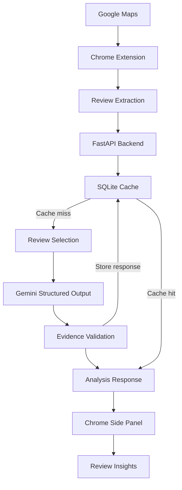

# Lumora for Google Maps

**A brighter way to choose.**

Lumora is a Chrome Extension that turns Google Maps reviews into a concise decision brief, practical visit information, recommended dishes, and aspect analysis with traceable review evidence.

**AI 消費決策助手｜讓每一次消費，都有更清晰的選擇。**

Lumora 將 Google Maps 評論整理為消費決策摘要、消費實用資訊、推薦餐點與可溯源的面向分析，方便在到訪前比較。

## Features | 核心功能

### 1. Consumer decision summary | 消費決策摘要

Summarizes what reviewers recommend and what visitors should consider before going.

### 2. Practical visit information | 消費實用資訊

Surfaces review-backed budget, wait times, reservations, parking, dining time limits, payment, and other useful details. Prices and policies may change.

### 3. Dishes and aspect analysis | 推薦餐點與面向分析

Displays recommended dishes, pros and cons linked to review evidence, and aspect scores. Gemini returns all four analysis areas in one Structured Output response.

### 4. Gemini / Mock Mode | AI 分析模式

- **Gemini Mode:** Uses the Gemini API for real AI analysis.
- **Mock Mode:** Derives deterministic mock results from the supplied reviews.
- Displays the current analysis mode in the Extension UI.

- **Gemini Mode：** 使用 Gemini API 進行實際 AI 分析。
- **Mock Mode：** 依輸入評論產生可重現的模擬結果，供本地開發與測試。
- Extension UI 會顯示目前使用的分析模式。


## Architecture | 系統架構




The backend selects up to 50 text-bearing reviews and 20,000 review-text characters. It deduplicates review IDs and applies a deterministic budget using review IDs. Concurrent misses with the same analysis key share one in-flight result and, when eligible, one Gemini call. Practical information is returned only when its source can be checked against the selected reviews.

## Data handling | 資料處理

分析由使用者主動發起。API 請求包含商家 ID、擷取時間，及每則評論的 ID、星等和正文。作者活動量、商家名稱與評論日期不由目前的 Extension 上傳。Chrome 工作階段只保存可展開的優缺點證據原文及結果，讓側欄重開後恢復。SQLite 快取有七天有效期，過期列於啟動、快取寫入或讀到過期項目時清理。Gemini 單輪請求使用 `store: false`，供應商的其他留存與帳戶條件仍須確認。

公開發布仍需要確認 Google Maps 內容授權、Gemini 與 Render 實際設定、正式政策及 Chrome Web Store 揭露。 [資料使用規格](docs/GOOGLE_MAPS_DATA_USAGE_SPEC.md) · [隱私政策雙語草稿](docs/PRIVACY_POLICY_DRAFT.md) · [合規與授權查核](docs/GOOGLE_MAPS_COMPLIANCE_REVIEW.md)

## Tech Stack | 技術架構

| Layer | Technologies |
|---|---|
| Browser Extension | Chrome Manifest V3, Side Panel |
| Frontend | React 18, TypeScript |
| Build Tools | Vite, CRXJS |
| Styling | Tailwind CSS |
| Backend | Python 3.11+, FastAPI |
| Data Validation | Pydantic v2 |
| Database / Cache | SQLite |
| AI | Google Gemini API, google-genai |
| Testing | pytest, httpx |


## Project Structure | 專案結構

```text
Review-Denoiser/
├── backend/
│   ├── app/
│   │   ├── api/
│   │   ├── core/
│   │   ├── schemas/
│   │   ├── services/
│   │   │   ├── llm_absa.py
│   │   │   ├── review_selection.py
│   │   │   └── ...
│   │   ├── cache.py
│   │   └── main.py
│   ├── tests/
│   ├── pyproject.toml
│   └── requirements.txt
│
├── extension/
│   ├── src/
│   ├── public/
│   ├── package.json
│   └── vite.config.ts
│
├── AGENTS.md
└── README.md
```


## Getting Started | 安裝與啟動

### Prerequisites | 環境需求

- Python 3.11+
- Node.js and npm
- Google Chrome
- Gemini API Key (optional for Mock Mode)

### 1. Backend Setup | 後端設定

Install dependencies:

```powershell
cd backend
python -m pip install -e ".[dev,gemini]"
```

Configure environment variables in PowerShell:

**Gemini Mode**

```powershell
$env:GEMINI_API_KEY="YOUR_API_KEY"
$env:GEMINI_MODEL="gemini-3.5-flash-lite"
$env:MOCK_LLM="false"
```

**Mock Mode**

```powershell
$env:MOCK_LLM="true"
```

Start the backend:

```powershell
uvicorn app.main:app --reload --no-proxy-headers
```

Backend API:

- Health Check: `http://127.0.0.1:8000/health`
- API Endpoint: `POST http://127.0.0.1:8000/api/v1/analyze`

#### API Protection | API 防護

| 環境變數 | 預設 | 用途 |
| --- | --- | --- |
| `FORWARDED_ALLOW_IPS` | 空白 | 使用 `python -m app.serve` 時，只有列出的代理 IP 或 CIDR 可以讓 Uvicorn 解析轉送標頭。空白時使用直接連線來源。 |
| `RATE_LIMIT_REQUESTS` | `5` | 每個用戶端在滑動時間窗內可送出的分析請求數。 |
| `RATE_LIMIT_WINDOW` | `60` | 限流窗的秒數。 |
| `RATE_LIMIT_MAX_CLIENTS` | `10000` | 單一程序保留的用戶端計數上限。滿載時拒絕新的用戶端計數，並定期清理過期紀錄。 |
| `MAX_REQUEST_BODY_BYTES` | `524288` | API 分析請求的 HTTP body bytes 上限。 |
| `GEMINI_DAILY_CALL_LIMIT` | `100` | 每個 SQLite 檔案的每日 Gemini 呼叫保留次數，於 UTC 午夜重置。 |
| `GEMINI_CONCURRENT_CALL_LIMIT` | `2` | 同一程序中實際執行的 Gemini 呼叫上限。 |
| `GEMINI_MAX_REQUEST_BYTES` | `262144` | Gemini 請求 JSON 的應用程式端 UTF-8 預算，包含 prompt、評論、ID、Schema 及結構開銷。 |
| `GEMINI_MAX_OUTPUT_TOKENS` | `4096` | 透過 Interactions API 設定的模型輸出 token 上限。 |

分析 API 接收最多 50 則評論。Place ID、Review ID、相對時間及評論正文分別最多 512、256、128、5,000 個 Unicode 字元。Extension 會縮短過長的正文與相對時間。過長的 Review ID 會排除，過長的 Place ID 會拒絕。若整批 JSON 仍超過 512 KiB，Extension 將使用相同的正文上限縮短各則評論。評論順序與有效 ID 保留，側欄原文使用送出的版本。直接 API 呼叫須符合欄位限制。若伺服器設定的 body 上限低於 Extension 的傳輸上限，伺服器可能回傳 `413 REQUEST_BODY_TOO_LARGE`。

部署目標為單 instance、單 worker。入口 `python -m app.serve` 固定啟動一個 worker，instance 數在 Render 設定。須先確認 Render 的直連代理範圍、代理如何處理 `X-Forwarded-For`，以及不同外部使用者是否得到獨立的限流身分，再配置可信代理。若未配置，應用程式會將代理的連線 IP 當作來源，經由同一代理的請求可能共用限流。來源設定及 CORS 不提供 API 身分驗證。

SQLite 每日額度寫入 `DATABASE_PATH` 所指檔案的獨立資料表。Render 須將該路徑放到持久磁碟的掛載目錄，暫存磁碟重啟或重新部署可能失去額度狀態。Per-client 限流與 Gemini 併發席位是程序內狀態，多 worker 會分開計數，不同 replica 的 SQLite 檔案也各自計數。擴展前應在共享入口執行限流，並選用能原子保留每日額度及管理全站併發席位的共享儲存。

Cache hit、Mock Mode 與無可分析評論皆不保留配額。已保留的實際模型呼叫次數不因逾時、取消或供應商錯誤退回。20,000 字元正文預算、UTF-8 bytes、輸出 token 與每日呼叫量是不同的限制。提供者可能計入模型思考等用量，這些設定無法換算為精確金額上限。

#### Single-flight and SQLite concurrency | 分析協調與快取一致性

Single-flight 使用完整評論請求指紋、分析模式、指定模型、Prompt 雜湊、快取格式及模型預算組成分析 key。程序同時最多登記 16 個 leader 與 16 個等待者，等待者最多等 45 秒。登記後 leader 會重查快取。連線中斷或等待逾時只影響該次 HTTP 請求。已開始的模型呼叫會繼續到完成或 SDK 逾時，並依既有額度規則釋放席位。共用新結果仍回傳 `cache_hit: false`。若 leader 重查時已讀到 SQLite 資料，所有收到該快取結果的請求均回傳 `cache_hit: true`。

SQLite 保留每個 Place ID 一筆、七天 TTL 及 v4 格式。不同輸入可各自完成，最後成功提交的寫入保留在資料庫，後續讀取仍須比對完整指紋與分析 key。舊 v4 只在回應可驗證且記錄的模式與模型相符時重用。缺少模型資訊的 Gemini 舊快取會在下一次分析時更新。移除過期或壞資料時會核對原先讀到的資料版本。Single-flight 限於同一程序，服務重啟會遺失進行中協調狀態。多 worker 或 replica 需要共享協調機制，SQLite 共用檔案也無法提供跨程序 Single-flight。

### 2. Extension Setup | 擴充功能設定

Install dependencies:

```powershell
cd extension
npm install
```

Build the Extension:

```powershell
npm run typecheck
npm run build
```

Load the Extension in Chrome:

1. Open `chrome://extensions`.
2. Enable **Developer mode**.
3. Click **Load unpacked**.
4. Select the `extension/dist/` directory.

Open Google Maps, navigate to a business, select its Reviews section, and open the extension's Side Panel.


## Testing | 測試方式

### Backend Tests

```powershell
cd backend
pytest
```

### Extension Type Checking

```powershell
cd extension
npm run typecheck
```

### Extension Production Build

```powershell
npm run build
```


## Current Limitations | 目前限制

- Review extraction depends on Google Maps DOM structure, which may change over time.
- The Extension currently extracts up to 50 reviews per collection.
- The backend API is configured for local development at `127.0.0.1:8000`.
- Gemini analysis requires a valid API Key unless Mock Mode is enabled.
- AI-generated insights may not represent every customer's experience and should be interpreted alongside the original review evidence.

- 評論擷取依賴 Google Maps DOM 結構，網站更新可能影響擷取功能。
- Extension 目前每次最多擷取 50 則評論。
- Backend API 目前以本機 `127.0.0.1:8000` 作為開發環境。
- 除非啟用 Mock Mode，否則 Gemini 分析需要有效的 API Key。
- AI 分析結果不一定能代表所有消費者的體驗，應搭配原始評論證據判讀。


## Future Improvements | 未來改善方向

- Improve review extraction reliability.
- Improve sentiment analysis quality and evidence consistency.
- Add configurable backend deployment settings.
- Expand automated testing and integration coverage.

- 提升評論擷取的穩定性。
- 提升情感分析品質及證據一致性。
- 增加可配置的 Backend 部署設定。
- 擴充自動化測試與整合測試。


## License

This project is developed for learning, experimentation, and portfolio demonstration.
