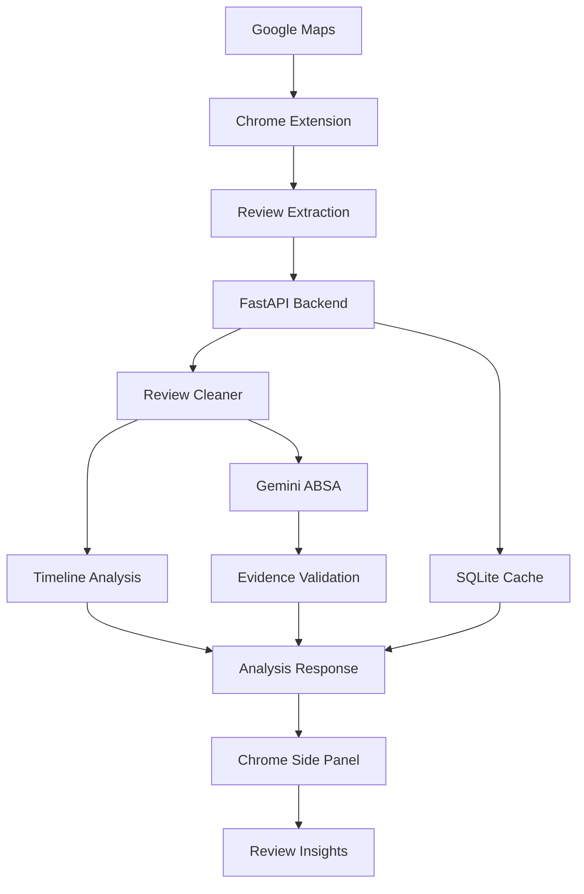

# Google Maps Review De-noiser

**An AI-powered Chrome Extension that analyzes Google Maps reviews, filters suspicious feedback, identifies sentiment patterns, and detects potential negative review trends.**

**一款 AI 的 Chrome 擴充叉件，分析 Google Maps 商家評論、過濾可疑評論、整理情感分析結果，並偵測潛在的負評趨勢。**


## Overview | 專案介紹

Google Maps reviews provide valuable insights into customer experiences, but manually reading hundreds of reviews can be time-consuming. Some reviews may also contain promotional content or suspicious feedback that affects the overall perception of a business.

Google Maps 評論能反映消費者的真實體驗，但當評論數量龐大時，逐則閱讀相當耗時。此外，部分評論可能包含業配內容或可疑資訊，影響使用者對商家的判斷。

**Google Maps Review De-noiser** addresses these problems through three core capabilities:

本專案透過三項核心功能解決上述問題：

1. **Review Cleaner** — Detects and filters potentially suspicious reviews.
2. **Review Timeline** — Visualizes review trends and identifies unusual increases in negative feedback.
3. **AI-powered Aspect-Based Sentiment Analysis (ABSA)** — Extracts business strengths and weaknesses with evidence linked to original reviews.


## Features | 核心功能

### 1. Review Cleaner | 可疑評論過濾

- Identifies potentially promotional or suspicious reviews using rule-based heuristics.
- Assigns suspicious scores based on review content, ratings, and reviewer activity.
- Preserves original review information for traceability.

- 使用規則式方法辨識可能的業配或可疑評論。
- 根據評論內容、評分及評論者留言資訊計算可疑分數。
- 保留原始評論資訊，方便追溯。

### 2. Review Timeline | 評論趨勢分析

**Anomaly Detection Rules**
- Uses non-suspicious reviews with valid timestamps.
- Compares negative review ratios between the recent 60-day period and historical data.
- Requires at least 5 recent reviews.
- Triggers an alert when the recent negative ratio exceeds 1.5 times the historical ratio.
- Does not trigger alerts when historical data is unavailable.

**異常偵測規則**
- 僅使用非可疑且具有有效時間戳記的評論。
- 比較近 60 天與歷史評論的負評比例。
- 近期至少需要 5 則評論。
- 當近期負評比例超過歷史比例的 1.5 倍時觸發警報。
- 缺乏歷史資料時不觸發警報。

### 3. AI-powered ABSA | AI 面向情感分析

Uses Gemini Structured Output to extract structured business insights.

透過 Gemini Structured Output，將評論轉換成結構化的商家分析結果。


### 4. Gemini / Mock Mode | AI 分析模式

- **Gemini Mode:** Uses the Gemini API for real AI analysis.
- **Mock Mode:** Uses predefined mock results for local development and testing.
- Displays the current analysis mode in the Extension UI.

- **Gemini Mode：** 使用 Gemini API 進行實際 AI 分析。
- **Mock Mode：** 使用預設模擬結果，方便本地開發與測試。
- Extension UI 會顯示目前使用的分析模式。


## Architecture | 系統架構




## Tech Stack | 技術架構

| Layer | Technologies |
|---|---|
| Browser Extension | Chrome Manifest V3, Side Panel |
| Frontend | React 18, TypeScript |
| Build Tools | Vite, CRXJS |
| Styling | Tailwind CSS |
| Visualization | Recharts |
| Backend | Python 3.11+, FastAPI |
| Data Validation | Pydantic v2 |
| Database / Cache | SQLite |
| AI | Google Gemini API, google-genai |
| Testing | pytest, httpx |


## Project Structure | 專案結構

```text
Review-Denoiser/
├── backend/
│   ├── app/
│   │   ├── api/
│   │   ├── core/
│   │   ├── schemas/
│   │   ├── services/
│   │   │   ├── cleaner.py
│   │   │   ├── llm_absa.py
│   │   │   └── timeline.py
│   │   ├── cache.py
│   │   └── main.py
│   ├── tests/
│   ├── pyproject.toml
│   └── requirements.txt
│
├── extension/
│   ├── src/
│   ├── public/
│   ├── package.json
│   └── vite.config.ts
│
├── AGENTS.md
└── README.md
```


## Getting Started | 安裝與啟動

### Prerequisites | 環境需求

- Python 3.11+
- Node.js and npm
- Google Chrome
- Gemini API Key (optional for Mock Mode)

### 1. Backend Setup | 後端設定

Install dependencies:

```powershell
cd backend
python -m pip install -e ".[dev,gemini]"
```

Configure environment variables in PowerShell:

**Gemini Mode**

```powershell
$env:GEMINI_API_KEY="YOUR_API_KEY"
$env:GEMINI_MODEL="gemini-3.5-flash-lite"
$env:MOCK_LLM="false"
```

**Mock Mode**

```powershell
$env:MOCK_LLM="true"
```

Start the backend:

```powershell
uvicorn app.main:app --reload
```

Backend API:

- Health Check: `http://127.0.0.1:8000/health`
- API Endpoint: `POST http://127.0.0.1:8000/api/v1/analyze`

### 2. Extension Setup | 擴充功能設定

Install dependencies:

```powershell
cd extension
npm install
```

Build the Extension:

```powershell
npm run typecheck
npm run build
```

Load the Extension in Chrome:

1. Open `chrome://extensions`.
2. Enable **Developer mode**.
3. Click **Load unpacked**.
4. Select the `extension/dist/` directory.

Open Google Maps, navigate to a business, select its Reviews section, and open the Review Denoiser Side Panel.


## Testing | 測試方式

### Backend Tests

```powershell
cd backend
pytest
```

### Extension Type Checking

```powershell
cd extension
npm run typecheck
```

### Extension Production Build

```powershell
npm run build
```


## Current Limitations | 目前限制

- Review extraction depends on Google Maps DOM structure, which may change over time.
- The Extension currently extracts up to 50 reviews per collection.
- The backend API is configured for local development at `127.0.0.1:8000`.
- Gemini analysis requires a valid API Key unless Mock Mode is enabled.
- AI-generated insights may not represent every customer's experience and should be interpreted alongside the original review evidence.

- 評論擷取依賴 Google Maps DOM 結構，網站更新可能影響擷取功能。
- Extension 目前每次最多擷取 50 則評論。
- Backend API 目前以本機 `127.0.0.1:8000` 作為開發環境。
- 除非啟用 Mock Mode，否則 Gemini 分析需要有效的 API Key。
- AI 分析結果不一定能代表所有消費者的體驗，應搭配原始評論證據判讀。


## Future Improvements | 未來改善方向

- Improve review extraction reliability.
- Enhance suspicious review detection with more contextual signals.
- Improve sentiment analysis quality and evidence consistency.
- Add configurable backend deployment settings.
- Expand automated testing and integration coverage.

- 提升評論擷取的穩定性。
- 加入更多上下文特徵，改善可疑評論辨識。
- 提升情感分析品質及證據一致性。
- 增加可配置的 Backend 部署設定。
- 擴充自動化測試與整合測試。


## License

This project is developed for learning, experimentation, and portfolio demonstration.