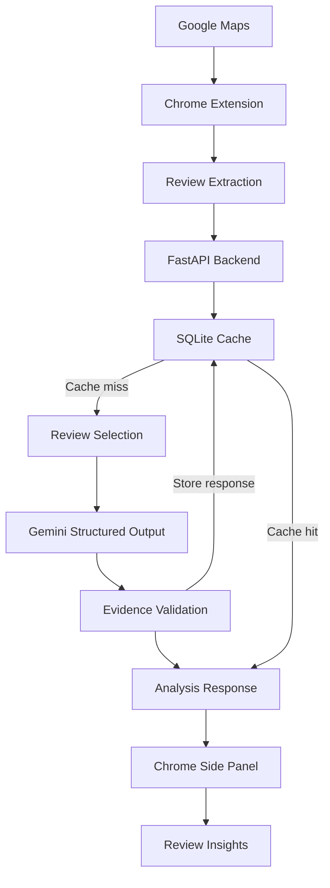

# Lumora for Google Maps

**A brighter way to choose.**

Lumora is a Chrome Extension that turns Google Maps reviews into a concise decision brief, practical visit information, recommended dishes, and aspect analysis with traceable review evidence.

**AI 消費決策助手｜讓每一次消費，都有更清晰的選擇。**

Lumora 將 Google Maps 評論整理為消費決策摘要、消費實用資訊、推薦餐點與可溯源的面向分析，方便在到訪前比較。

## Features | 核心功能

### 1. Consumer decision summary | 消費決策摘要

Summarizes what reviewers recommend and what visitors should consider before going.

### 2. Practical visit information | 消費實用資訊

Surfaces review-backed budget, wait times, reservations, parking, dining time limits, payment, and other useful details. Prices and policies may change.

### 3. Dishes and aspect analysis | 推薦餐點與面向分析

Displays recommended dishes, pros and cons linked to review evidence, and aspect scores. Gemini returns all four analysis areas in one Structured Output response.

### 4. Gemini / Mock Mode | AI 分析模式

- **Gemini Mode:** Uses the Gemini API for real AI analysis.
- **Mock Mode:** Derives deterministic mock results from the supplied reviews.
- Displays the current analysis mode in the Extension UI.

- **Gemini Mode：** 使用 Gemini API 進行實際 AI 分析。
- **Mock Mode：** 依輸入評論產生可重現的模擬結果，供本地開發與測試。
- Extension UI 會顯示目前使用的分析模式。


## Architecture | 系統架構




The backend selects up to 50 text-bearing reviews and 20,000 review-text characters. It deduplicates review IDs and applies a deterministic budget using review IDs. A cache miss with eligible reviews triggers one Gemini request; a cache hit reuses the result. Practical information is returned only when its source can be checked against the selected reviews.

## Tech Stack | 技術架構

| Layer | Technologies |
|---|---|
| Browser Extension | Chrome Manifest V3, Side Panel |
| Frontend | React 18, TypeScript |
| Build Tools | Vite, CRXJS |
| Styling | Tailwind CSS |
| Backend | Python 3.11+, FastAPI |
| Data Validation | Pydantic v2 |
| Database / Cache | SQLite |
| AI | Google Gemini API, google-genai |
| Testing | pytest, httpx |


## Project Structure | 專案結構

```text
Review-Denoiser/
├── backend/
│   ├── app/
│   │   ├── api/
│   │   ├── core/
│   │   ├── schemas/
│   │   ├── services/
│   │   │   ├── llm_absa.py
│   │   │   ├── review_selection.py
│   │   │   └── ...
│   │   ├── cache.py
│   │   └── main.py
│   ├── tests/
│   ├── pyproject.toml
│   └── requirements.txt
│
├── extension/
│   ├── src/
│   ├── public/
│   ├── package.json
│   └── vite.config.ts
│
├── AGENTS.md
└── README.md
```


## Getting Started | 安裝與啟動

### Prerequisites | 環境需求

- Python 3.11+
- Node.js and npm
- Google Chrome
- Gemini API Key (optional for Mock Mode)

### 1. Backend Setup | 後端設定

Install dependencies:

```powershell
cd backend
python -m pip install -e ".[dev,gemini]"
```

Configure environment variables in PowerShell:

**Gemini Mode**

```powershell
$env:GEMINI_API_KEY="YOUR_API_KEY"
$env:GEMINI_MODEL="gemini-3.5-flash-lite"
$env:MOCK_LLM="false"
```

**Mock Mode**

```powershell
$env:MOCK_LLM="true"
```

Start the backend:

```powershell
uvicorn app.main:app --reload
```

Backend API:

- Health Check: `http://127.0.0.1:8000/health`
- API Endpoint: `POST http://127.0.0.1:8000/api/v1/analyze`

### 2. Extension Setup | 擴充功能設定

Install dependencies:

```powershell
cd extension
npm install
```

Build the Extension:

```powershell
npm run typecheck
npm run build
```

Load the Extension in Chrome:

1. Open `chrome://extensions`.
2. Enable **Developer mode**.
3. Click **Load unpacked**.
4. Select the `extension/dist/` directory.

Open Google Maps, navigate to a business, select its Reviews section, and open the extension's Side Panel.


## Testing | 測試方式

### Backend Tests

```powershell
cd backend
pytest
```

### Extension Type Checking

```powershell
cd extension
npm run typecheck
```

### Extension Production Build

```powershell
npm run build
```


## Current Limitations | 目前限制

- Review extraction depends on Google Maps DOM structure, which may change over time.
- The Extension currently extracts up to 50 reviews per collection.
- The backend API is configured for local development at `127.0.0.1:8000`.
- Gemini analysis requires a valid API Key unless Mock Mode is enabled.
- AI-generated insights may not represent every customer's experience and should be interpreted alongside the original review evidence.

- 評論擷取依賴 Google Maps DOM 結構，網站更新可能影響擷取功能。
- Extension 目前每次最多擷取 50 則評論。
- Backend API 目前以本機 `127.0.0.1:8000` 作為開發環境。
- 除非啟用 Mock Mode，否則 Gemini 分析需要有效的 API Key。
- AI 分析結果不一定能代表所有消費者的體驗，應搭配原始評論證據判讀。


## Future Improvements | 未來改善方向

- Improve review extraction reliability.
- Improve sentiment analysis quality and evidence consistency.
- Add configurable backend deployment settings.
- Expand automated testing and integration coverage.

- 提升評論擷取的穩定性。
- 提升情感分析品質及證據一致性。
- 增加可配置的 Backend 部署設定。
- 擴充自動化測試與整合測試。


## License

This project is developed for learning, experimentation, and portfolio demonstration.
