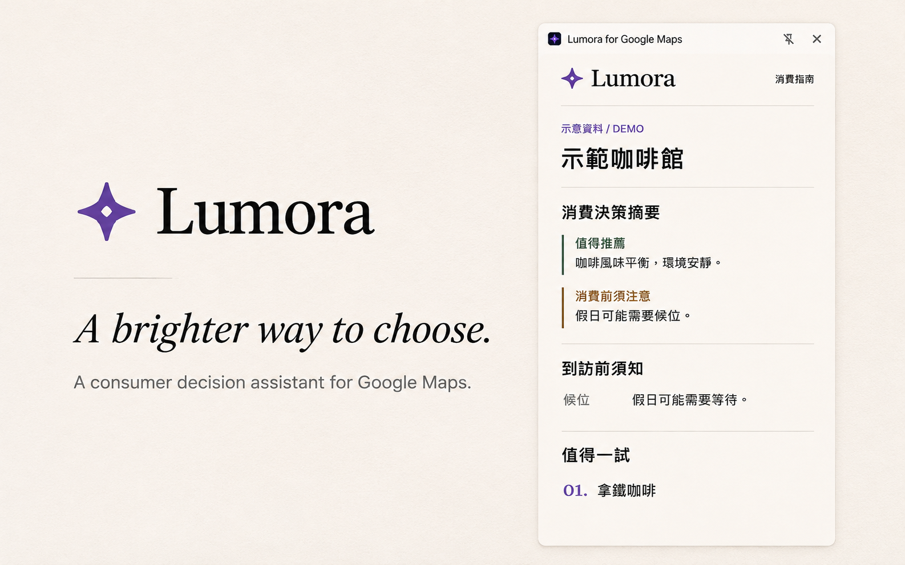
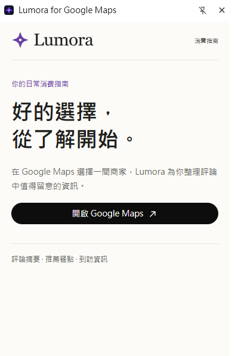
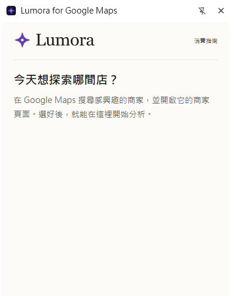
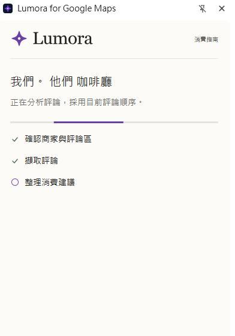
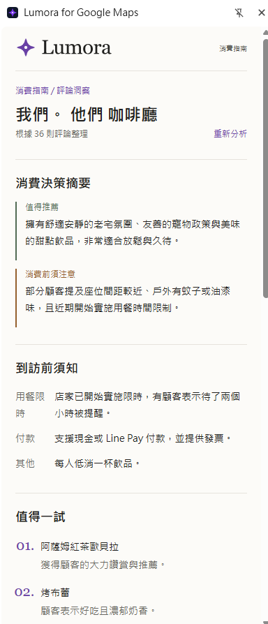
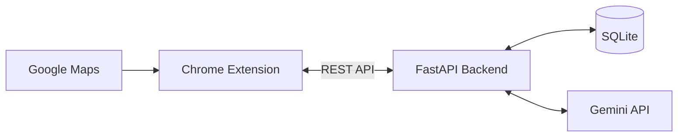
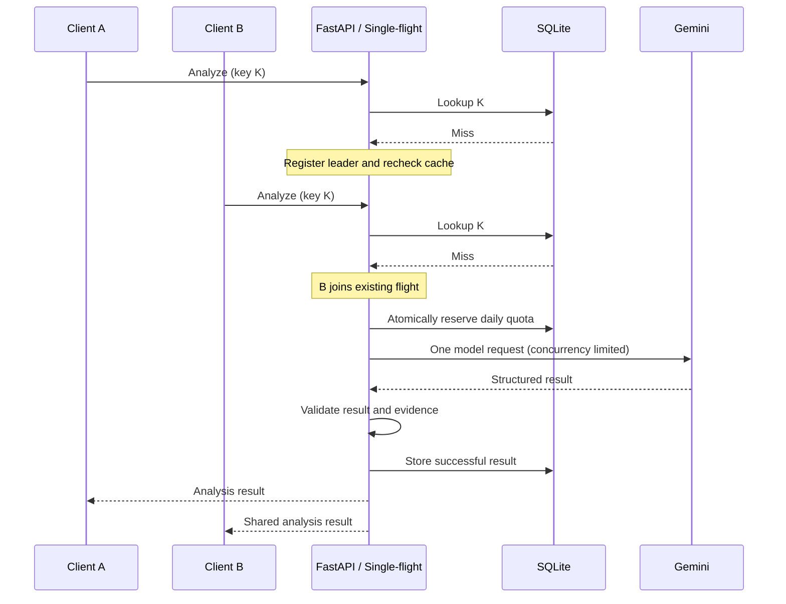

# Lumora



[](https://chromewebstore.google.com/detail/lumora-for-google-maps/alcgbbggeoheolgjgllkblippjidemnk)


An AI-powered consumer decision assistant for Google Maps, built as a Chrome Manifest V3 extension with a FastAPI backend.

AI 消費決策助手｜讓每一次消費，都有更清晰的選擇。

Lumora turns a collection of reviews into a concise decision brief, practical visit information, recommended dishes, and aspect-based analysis. Rather than asking users to read dozens of individual reviews, it organizes the information they need before visiting a business, with original review evidence available for the strengths and weaknesses identified in the analysis.


[Features](#features) · [Architecture](#architecture) · [Engineering](#engineering-highlights) · [Quick start](#quick-start) · [Testing](#testing)

## Product preview

<p align="center">
  
  &nbsp;&nbsp;
  
  
  
</p>


## Features

| Feature | Description |
| --- | --- |
| Decision brief | Summarizes what visitors may appreciate and what they should consider before visiting. |
| Practical visit information | Extracts review-backed information about budget, waiting times, reservations, parking, dining time limits, and payment. |
| Recommended dishes | Organizes dishes mentioned favorably in the selected reviews. |
| Aspect analysis | Presents aspect scores, strengths, weaknesses, and expandable original review evidence for pros and cons. |
| Analysis modes | Supports Gemini for model-generated analysis and a deterministic Mock mode for local development without an API key. |


## Architecture




## Engineering highlights

| Engineering concern | Implementation |
| --- | --- |
| Duplicate model calls | Process-local single-flight coordination coalesces concurrent cache misses with the same analysis key. The leader rechecks the cache before executing; followers share its result without reserving additional model quota. |
| Cache consistency | SQLite caching uses input fingerprints, analysis configuration, a seven-day TTL, and conditional invalidation to prevent stale readers from deleting newly written results. |
| API protection | Bounded per-client sliding-window rate limiting, explicit trusted-proxy configuration, HTTP body-size enforcement before JSON parsing, and field-level input validation. |
| Model resource management | SQLite-backed atomic daily quota reservations, process-local concurrency limits, serialized input-size limits, and output-token limits. SDK automatic retries and continuation are disabled. |
| Extension reliability | Merchant identity validation, task deduplication and cancellation, stale-message protection, session restoration, and runtime validation of successful API responses. |
| Privacy-oriented processing | Nonessential author metadata is no longer collected; dates and merchant names stay in the browser. Session snapshots retain only the review evidence needed by the visible pros and cons. Gemini requests explicitly disable interaction storage. |

### Request coalescing




## Technology stack

| Layer | Technologies |
| --- | --- |
| Browser extension | Chrome Manifest V3, Side Panel, Content Scripts, Service Worker |
| Frontend | React 18, TypeScript, Tailwind CSS |
| Build tooling | Vite, CRXJS |
| Backend | Python 3.11+, FastAPI, Pydantic v2 |
| Persistence | SQLite |
| Model integration | Google Gemini API, Google GenAI SDK |
| Testing | pytest, httpx, Extension regression tests |

## Quick start

The following commands use Windows PowerShell. The local demonstration uses Mock mode and does not require a Gemini API key or live Google Maps reviews.

### Prerequisites

- Python 3.11+ (validated with 3.12.4)
- Node.js and npm (validated with Node.js 20.11.0 and npm 10.2.4)
- Google Chrome (for loading the extension)

### 1. Start the backend

From the repository root:

```powershell
cd backend
python -m venv .venv
.\.venv\Scripts\Activate.ps1
python -m pip install -r requirements.txt
$env:MOCK_LLM="true"
python -m uvicorn app.main:app --reload --no-proxy-headers
```

- Health check: `http://127.0.0.1:8000/health`
- Analysis endpoint: `POST http://127.0.0.1:8000/api/v1/analyze`

### 2. Try the API with synthetic reviews

In a separate PowerShell window:

```powershell
$body = @{
    place_id = "demo-cafe"
    scraped_at = (Get-Date).ToUniversalTime().ToString("o")
    reviews = @(
        @{ review_id = "demo-1"; rating = 5; text = "The coffee and cheesecake were excellent." },
        @{ review_id = "demo-2"; rating = 3; text = "We waited 20 minutes for a table." }
    )
} | ConvertTo-Json -Depth 5

Invoke-RestMethod `
    -Uri "http://127.0.0.1:8000/api/v1/analyze" `
    -Method Post `
    -ContentType "application/json" `
    -Body $body
```

The response should report Mock mode. The exact analysis content depends on the deterministic mock rules. These are fictional reviews, not Google Maps content.

### 3. Build and load the Chrome extension

From the repository root in another terminal:

```powershell
cd extension
npm ci
npm run typecheck
npm run build:local
```

Open `chrome://extensions`, enable **Developer mode**, select **Load unpacked**, and choose `extension/dist/`.

The local build targets `http://127.0.0.1:8000`. Loading the extension alone does not populate the side panel with the synthetic API example above. Live Google Maps collection is not required for the API demonstration and should not be used for public distribution without an appropriate authorization basis.

### Optional: Gemini mode

For authorized inputs, configure a Gemini API key in the backend environment and restart the server:

```powershell
$env:GEMINI_API_KEY="YOUR_API_KEY"
$env:GEMINI_MODEL="gemini-3.5-flash-lite"
$env:MOCK_LLM="false"
```

The model setting is the one documented in the supplied project configuration; verify availability and account terms before using it. Never commit API keys. See `backend/.env.example` for configuration options.

### Local and production builds

| Command | Purpose |
| --- | --- |
| `npm run build:local` | Local API at `http://127.0.0.1:8000` |
| `npm run build:prod` | Configured production HTTPS API |

The build derives API host permissions from the configured endpoint. Production builds exclude local API permissions. A successful production build is not proof of successful deployment or authorization to distribute.

## Testing

| Suite | Latest reported results |
| --- | ---: |
| Backend | 201 passed |
| Extension | 94 passed |
| Total | 295 passed |

The final engineering review also reported successful type checking, local and production builds, and clean-environment installation. Regression tests cover API validation, concurrent requests, quota accounting, cache races, task cancellation, merchant isolation, and data retention.

Run the backend suite from `backend/`:

```powershell
python -m pytest
```

From `extension/`, run type checking and build verification:

```powershell
npm run typecheck
npm run build:prod
npm run build:local
```

Use the test script declared in `extension/package.json` to run the extension regression suite. The last local build restores the development endpoint. The reported test counts are not a measure of code coverage.

## Project structure

```text
.
├── backend/
│   ├── app/
│   │   ├── api/                 # API routes
│   │   ├── core/                # Schemas and settings
│   │   ├── services/            # Review selection, model integration and limits
│   │   ├── body_limit.py        # HTTP body protection
│   │   ├── cache.py             # SQLite caching
│   │   ├── rate_limit.py        # Per-client rate limiting
│   │   ├── singleflight.py      # In-flight request coordination
│   │   ├── serve.py             # Server startup configuration
│   │   └── main.py              # FastAPI application
│   ├── tests/
│   └── requirements.txt
├── extension/
│   ├── src/                     # UI, collection and background coordination
│   ├── public/                  # Extension assets
│   ├── tests/
│   ├── package.json
│   ├── package-lock.json
│   └── vite.config.ts
├── docs/                        # Technical, privacy and compliance documentation
├── AGENTS.md
└── README.md
```

## Privacy and known limitations

- Google Maps DOM changes may affect review collection. Live Chrome end-to-end behavior, slow service-worker requests, and specific session cleanup races still require verification.
- Evidence ID and excerpt validation do not establish that every model-generated claim is semantically supported. Visit information may be outdated, and the current UI does not expose original review evidence for every analysis section.
- The seven-day cache TTL is an eligibility period, not a guarantee of immediate physical deletion. Expired entries are removed through cleanup triggered by cache operations or startup.
- Gemini `store: false` disables interaction storage; it does not establish zero data retention or exclude other provider processing.
- Production proxy configuration, disk persistence, provider account settings, dependency scanning, and public API abuse protection require deployment-specific verification.

## Project and release status

Lumora is developed for learning and portfolio demonstration. A local Mock-mode API demonstration with synthetic reviews has been verified in the final engineering review. Public release remains blocked pending an appropriate authorization basis for Google Maps content collection, transfer, storage and redisplay, production environment verification, and final privacy and store disclosures.

- [Data usage specification](docs/GOOGLE_MAPS_DATA_USAGE_SPEC.md)
- [Privacy policy draft](docs/PRIVACY_POLICY_DRAFT.md)
- [Compliance review and release requirements](docs/GOOGLE_MAPS_COMPLIANCE_REVIEW.md)
